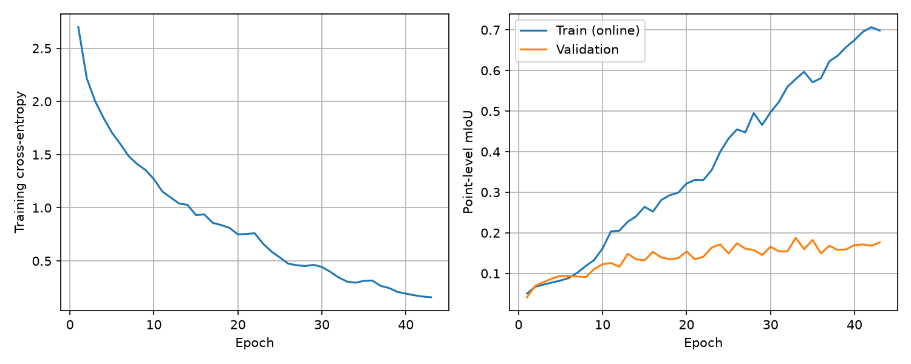

# ROB 498/599 — 3D Robot Perception: lab starter code

Starter code for the lab. Clone it, make the environment, and start filling in
the stubs.

```bash
git clone https://github.com/bucherb/rob-3d-perception-lab.git && cd rob-3d-perception-lab
conda env create -f environment.yml && conda activate rob498
pip install -e .
python scripts/check_env.py            # on a GPU node: python scripts/check_env.py --gpu
pytest rob498/tests lab1/tests -v
```

## Part B: measured 5 cm baseline

On the prepared ScanNet20 subset (10 training scenes, 2 validation scenes;
subset-selection seed 42), the compact sparse U-Net was trained from scratch
on an NVIDIA RTX 4090 with training seed 42 and 5 cm voxels. Adam used a learning
rate of 0.001 and weight decay of 0.0001, with a 50-epoch budget and patience 10.
The best validation mIoU was **18.7303% at epoch 33**. Early stopping occurred at
epoch 43, and the epoch-33 weights were restored.



[Per-class IoU table (CSV)](report_assets/part_b_5cm_seed42/per_class_iou.csv).
IoUs are stored as fractions. The CSV's 17 defined class IoUs average to
0.1873028221; 14 classes have ground-truth points in the validation subset.
A blank IoU denotes absence from both predictions and ground truth. A zero IoU
can also occur for a class absent from ground truth but predicted incorrectly.

Training loss falls while online training mIoU rises to about 70%, but validation
mIoU remains below 19%, consistent with overfitting and limited generalization.
Training scores are collected during parameter updates; validation scores use
fixed end-of-epoch weights and evaluation mode. These are subset validation
results used for checkpoint selection, not independent test or full-benchmark
results. The chart and CSV alone do not establish that the evaluation pipeline
is free of errors. The epoch history and run metadata remain in the server's
`~/ROB599/results/part_b_seed42/voxel_5cm/` directory.

## Great Lakes Part B: ready to submit

This workflow uses the **ScanNet20 small-subset route discussed by the GSI**,
not the shared 2,878-class ScanNet++ export. Your prepared subset contains
10 training scenes and 2 validation scenes, selected with seed 42 from available
members of the official splits. Report these as subset results, not full-dataset
benchmark results. Original coordinates and all vertices are preserved; labels
are remapped to 0--19, with -1 ignored. Input RGB comes from the original mesh,
never the label-visualization colors.

The code below queues actual training when you choose to submit it. No jobs,
training runs or tests were launched while preparing these scripts.

First pull the committed code on **Great Lakes**, from your repository:

```bash
cd ~/ROB599-Lab1
GIT_ASKPASS= SSH_ASKPASS= git -c credential.helper= pull origin main
```

Use a valid GitHub token at the terminal password prompt if required. Do not
put tokens in commands, source files, logs or messages.

**First short run: 5 cm, two epochs.** Keep it separate from final experiments:

```bash
ROB498_EPOCHS=2 \
ROB498_RUN_ROOT=/scratch/engin_root/engin1/szlin/ROB599-Lab1/results/part_b_first_run \
sbatch scripts/train_part_b.sbatch
```

Submission returns a job ID immediately. You can disconnect while it waits or
runs. Follow its state and log (replace JOBID with the submitted number):

```bash
squeue -u szlin
tail -f slurm-part-b-JOBID_*.out
sacct -j JOBID --format=JobID,State,Elapsed,ExitCode,MaxRSS
```

Ctrl+C stops `tail -f`, not the job. To cancel the job, use `scancel JOBID`.
The script requests one A40 in `spgpu`, 4 CPUs, 32 GiB system memory, and a
2-hour walltime on `engin1`. That is a limit, not an estimate of training time.
The allocation is released when the command finishes. The script loads the
existing mamba module and `/home/szlin/mamba_envs/rob498`; it never installs
packages or downloads training data on the GPU node.

**Full Part B experiments:** after the short run finishes successfully,
train separate models at 2, 5 and 10 cm. Fifty is the maximum epoch count;
early stopping uses 10 epochs without validation improvement.

```bash
sbatch --array=0-2%1 scripts/train_part_b.sbatch
```

Array index 0 = 2 cm, 1 = 5 cm, 2 = 10 cm. `%1` runs at most one GPU job at a
time. Each task has its own 2-hour limit. These runs start from scratch with
training seed 42, on the same prepared subset. The default result directory is
`/scratch/engin_root/engin1/szlin/ROB599-Lab1/results/part_b_seed42/`.
To run only the full 5 cm model, omit `--array`.

**Schedule an earliest start** by adding an actual date/time:

```bash
sbatch --begin=2026-11-24T09:00:00 --array=0-2%1 scripts/train_part_b.sbatch
```

Check `date` on Great Lakes for its time zone. `--begin` sets eligibility, not
a guaranteed reservation: busy resources can delay the actual start.

**Continue after a time limit or interruption:** each completed epoch saves
`last.pth` with current weights, optimizer, shuffle RNG state and best weights.
Resume the interrupted array index; for example, the 2 cm run:

```bash
sbatch --array=0 scripts/train_part_b.sbatch --resume
```

Use `--array=1` for 5 cm or `--array=2` for 10 cm. Resume requires matching
data, scene selection, class names, model settings and seed. It restarts the
first unfinished epoch, not the middle of a scene. CUDA kernels may still be
nondeterministic. If no epoch finished, choose a new `ROB498_RUN_ROOT` and start
fresh rather than requesting resume without a `last.pth`. Never submit two
jobs writing to the same voxel-size directory simultaneously.

**Build B1/B2 report artifacts after the jobs finish**, without GPU training:

```bash
module load mamba/py3.12
source "$(conda info --base)/etc/profile.d/conda.sh"
conda activate /home/szlin/mamba_envs/rob498
python scripts/summarize_part_b.py \
  --runs /scratch/engin_root/engin1/szlin/ROB599-Lab1/results/part_b_seed42
```

This writes a conditions-bearing Markdown/CSV table, the mIoU/latency ablation
plot, per-class IoUs across voxel sizes, and class IoU drops from 2 to 10 cm.
Missing voxel sizes are explicitly flagged as incomplete. It refuses to combine
runs with different scenes or training conditions. This is lightweight reporting
on existing files, not another model fit.

**B3:** choose the classes relevant to your Part E occupancy rule and rerun
the same reporting command with `--task-classes`. For example, if you explicitly
choose chair, table and sofa as your task subset:

```bash
python scripts/summarize_part_b.py \
  --runs /scratch/engin_root/engin1/szlin/ROB599-Lab1/results/part_b_seed42 \
  --task-classes chair table sofa
```

That list is an example, not a course-required choice. Explain the selection in
the report. No retraining is needed. Until classes are selected, B3 is marked
unconfigured rather than reporting an invented task score.

Each `voxel_*cm/` directory contains:

- `best.pth`: weights selected by maximum validation mIoU.
- `last.pth`: resumable state after the latest completed epoch.
- `history.json` and `training_curves.png`: loss and train/validation mIoU.
- `metrics.json` and `per_class_iou.csv`: point-level scores and timing/memory.
- `validation_predictions.npz`: predictions, ground truth, scene offsets and
  the confusion matrix; the rows can be separated back into individual scenes.
- `run_config.json`, `manifest.json`, `status.json`: exact scene lists, label
  names, preparation metadata, settings, GPU, versions, commit and completion.

An absent class has undefined IoU (JSON null / blank CSV), not zero. Report
training mIoU as online and validation mIoU as end-of-epoch. Validation selects
the checkpoint, so it is not a separate held-out test set. Inference latency
is mean per-scene forward time after one warm-up; it excludes voxelization,
transfers and point remapping. GPU memory is peak PyTorch allocation. Training
time includes training, validation and checkpointing, plus previously completed
segments when resumed. Part E query latency is a separate measurement.

`lab1/run_lab1.py --part b` is also wired for direct use in an allocated GPU shell:

```bash
python -u lab1/run_lab1.py --part b \
  --data /scratch/engin_root/engin1/szlin/ROB599-Lab1/data/scannet20_small \
  --out /scratch/engin_root/engin1/szlin/ROB599-Lab1/results/part_b_direct \
  --seed 42 --b-voxel-sizes 0.05 --b-epochs 50
```

Direct-run outputs live under `<out>/part_b/`; pass that directory to the
summary tool. Do not run this command on a login node. No tests or training
have yet established runtime correctness or memory fit; the first short GPU
run is needed before calling the implementation validated.

For the written report, still inspect prediction quality, explain which
classes degrade in B2 and why, justify B3's task classes, and state the subset
and run conditions. Scripts produce measured artifacts, not those explanations.
Parts C--E remain separate work; Part E is 40 points of the lab.

## What this is, and what it deliberately is not

**Provided:** the shared `rob498/` package — SE(3) conventions, evaluation
metrics, file I/O in the exact deliverable formats, and the summary-table
builders. Plus, in `lab1/`, the plumbing around the algorithms: data
structures, the runner CLI, and helpers that are not the thing being assessed.

**Not provided:** the algorithms. Every function you are graded on raises
`NotImplementedError` with its part number and point value in the docstring.

The split follows the course policy: *you may not import a library that
implements the core algorithm you were asked to write.* So the TSDF baseline in
Lab 1 E2 may be fused with Open3D because it is a baseline, and the occupancy
query on it is yours.

## Why use the provided metrics rather than your own

Two reasons, both of which have cost students points in the past.

**Comparability.** "Accuracy" and "completeness" have several definitions in the
reconstruction literature and the numbers do not transfer between them. Lab 1
compares a splat surface (C3) with a feed-forward reconstruction (D3) *at one
fixed threshold*. That comparison is meaningless if the two used different
conventions, so `rob498.metrics.accuracy_completeness` fixes one and documents it.

**Traps that are easy to miss.** `ate_rmse` aligns before measuring, because
an unaligned ATE mostly measures how two world frames differ.
`iou_from_confusion` returns NaN for classes absent from both prediction and
truth rather than 0.0, which otherwise silently drags mIoU down. `read_tum`
matches trajectories *by timestamp*, because comparing by index produces a
plausible-looking wrong number.

If you think a provided metric is wrong, say so in your report with evidence.
That is a legitimate finding and it is graded as one.

## Layout

```
rob498/                 shared, provided
  se3.py                conventions, helpers, exp/log/adjoint -- all provided
  metrics.py            ATE, RPE, accuracy/completeness, IoU, binary rates, bootstrap CI
  io3d.py               TUM trajectories, depth back-projection, PLY, JSON, mesh sampling
  report.py             the required summary tables
  config.py             seeding + RunManifest (captures your run conditions)

  tests/                must pass from day one: `pytest rob498/tests`

lab1/  dataset.py (provided loader)
       segmentation.py splatting.py feedforward.py downstream.py  run_lab1.py
```

`lab1/tests/test_contracts.py` checks your code against the conventions. Run it early and often.

## What you implement

Every function below raises `NotImplementedError` until you write it. Its
docstring gives the part, the points, and what it must return. The handout's
point values are per part, and a part's report questions are graded alongside
its code.

| Part | File | Implement | Provided, use these |
|---|---|---|---|
| B1 (12) | `lab1/segmentation.py` | `build_model`, `train`, `evaluate` | `voxelize`, `SegmentationResult.metrics` |
| B2 (7) | `lab1/segmentation.py` | `voxel_size_ablation` | |
| B3 (6) | `lab1/segmentation.py` | nothing new; report questions | `SegmentationResult.subset_miou` |
| C1 (8) | `lab1/splatting.py` | `fit_splats` | `SplatModel` (with `validate`, `memory_mb`), `psnr` |
| C2 (6) | `lab1/splatting.py` | `extract_surface` | `filter_floaters` |
| C3 (6) | `lab1/splatting.py` | `evaluate_geometry` | `rob498.metrics` |
| D1 (5) | `lab1/feedforward.py` | `run_vggt` (no poses, no intrinsics) | `FeedForwardResult` |
| D2 (5) | `lab1/feedforward.py` | nothing new; report questions | `align_to_ground_truth`, `apply_sim3` |
| D3 (5) | `lab1/feedforward.py` | `evaluate_geometry` (takes D2's `sim3`) | `rob498.metrics` |
| E1 (8) | `lab1/downstream.py` | `label_ground_truth_occupancy` | `sample_task_configurations` (the 2,000 test positions, already restricted to observed space) |
| E2 (18) | `lab1/downstream.py` | `__init__`, `is_occupied` and `memory_mb` on each of `SegmentationOccupancy`, `SplatOccupancy`, `FeedForwardOccupancy`, and the `TSDFOccupancy` baseline | `evaluate_representations`, `time_queries` (the fixed query harness; do not modify) |
| E3 (10) | `lab1/downstream.py` | nothing new; explain the mechanism | `find_ranking_flip` |
| E4 (4) | report only | | |

You also wire the parts together in `_run_part` in `lab1/run_lab1.py`, which
raises `NotImplementedError` with a list of what each part calls. That is
plumbing and earns no points on its own, but it is how you produce the
numbers in your report:

```bash
python lab1/run_lab1.py --data data/lab1 --out results/ --part b   # or c, d, e, all
```

## Part B model

`build_model("minkowski", num_classes=C)` constructs a compact residual sparse
U-Net defined in `lab1/sparse_unet.py`, using spconv convolution primitives.
It is a MinkowskiNet-style architecture, not an exact MinkUNet34 reproduction,
and starts from random weights. PTv3 is not implemented.

```python
from lab1.segmentation import build_model

model = build_model(num_classes=C, in_channels=3).cuda()
logits = model(voxel_features, voxel_coordinates)  # (M, C), raw scores
```

Here `voxel_features` is a CUDA float32 tensor of shape `(M, 3)` (for example,
mean normalized RGB per voxel). `voxel_coordinates` is a CUDA int32 tensor of
shape `(M, 4)`, with columns `[batch, x, y, z]`. Voxel coordinates must be
unique and nonnegative; shift each scene's quantized coordinates before batching.
The output preserves input voxel row order. Use the provided voxelization inverse
mapping to recover per-point predictions. Set `C` from the dataset class list.

On the GPU server, after activating the lab environment, run:

```bash
python -m pytest lab1/tests/test_segmentation_model.py -v
```

The GPU test checks forward/backward execution and output correspondence after
permuting input voxels; it skips when PyTorch, spconv or CUDA is unavailable.

### Part B training and evaluation

The simple training functions take lists of `SegScene` objects directly: one
scene per step, with mean RGB features per voxel. They do not require a custom
PyTorch DataLoader. Training and mIoU both use original point labels, including
when several points fall into one voxel. Ignore labels are excluded.

Example Python script, run from the repository root in the GPU environment:

```python
import json
from pathlib import Path

from rob498.config import set_global_seed
from lab1.dataset import load_class_names, load_segmentation_split
from lab1.segmentation import build_model, train, evaluate, voxel_size_ablation

data = Path("data/lab1")
out = Path("results/part_b")
out.mkdir(parents=True, exist_ok=True)
train_scenes = load_segmentation_split(data, "train")
val_scenes = load_segmentation_split(data, "val")
num_classes = len(load_class_names(data))
models = {}

for size in (0.02, 0.05, 0.10):
    set_global_seed(0)  # Seed before creating each model's random weights.
    model = build_model(num_classes=num_classes)
    model, history = train(
        model, train_scenes, val_scenes,
        epochs=50, voxel_size=size, lr=0.001, patience=10, seed=0,
        device="cuda", checkpoint_path=out / f"model_{size:.2f}m.pth",
    )
    models[size] = model
    (out / f"history_{size:.2f}m.json").write_text(json.dumps(history, indent=2))

records = voxel_size_ablation(models, val_scenes)
(out / "ablation.json").write_text(json.dumps(records, indent=2))

# Example of inspecting point-level metrics for just the 5 cm model:
result = evaluate(models[0.05], val_scenes, voxel_size=0.05)
print(result.metrics(num_classes))
```

Training prints loss, online training mIoU, and validation mIoU each epoch.
It stops after `patience` epochs without improvement and restores the best
validation weights. The returned model records `best_epoch`, `best_val_miou`,
and `trained_voxel_size_m`. Checkpoints contain these conditions, model options,
the best weights, and the full epoch history. A companion `last.pth` supports
optimizer resumption with `resume_from=...`. Plot `train_miou` and `val_miou` from the history against `epoch`
for the training curves in your report.

The ablation saves `results/part_b/voxel_size_ablation.png` with mIoU and mean
forward latency against voxel size. Pass `plot_path=...` to choose another path,
or `plot_path=None` to return records without making a plot. Latency excludes
voxelization, data transfer and point remapping; the first scene is warmed up.
Reported memory is peak PyTorch-allocated GPU memory during inference in MiB,
including all live tensors on the device. During ablation, inactive compared
models are temporarily moved to CPU, then returned to their original devices.
CPU evaluation reports GPU memory as zero.
Full scenes are used without cropping; if a scene exceeds GPU memory, add an
explicit training crop strategy rather than silently dropping evaluation points.
Part B in `run_lab1.py` is wired; the Great Lakes batch workflow above is preferred.

## Prepare one ScanNet evaluation scene for C--E

Use the instructor-assigned evaluation scene if one is specified. `scene0000_00`
below is a development example, not an asserted course-required scene. Select
one scene once and reuse its prepared images, split and GT mesh across C, D and
E. The Part B segmentation NPZ files alone cannot supply the required RGB-D
frames and camera calibration.

On the RTX 4090 server, transfer only the recording, high-quality mesh and
optional scene metadata from Great Lakes:

```bash
mkdir -p ~/ROB599/raw/scene0000_00
rsync -avh --info=progress2 \
  -e 'ssh -o PubkeyAuthentication=no' \
  --include='scene0000_00.sens' \
  --include='scene0000_00_vh_clean.ply' \
  --include='scene0000_00.txt' --exclude='*' \
  szlin@greatlakes.arc-ts.umich.edu:/scratch/rob498_rob598s002f26_class_root/rob498_rob598s002f26_class/shared_data/scannet_dataset/dataset/scans/scene0000_00/ \
  ~/ROB599/raw/scene0000_00/
```

Authenticate with your U-M credentials and MFA, not a GitHub token. This copies
one scene, not the full dataset. Its `.sens` recording is several GB; the 27 MB
segmentation subset does not include that recording.

After getting `scripts/prepare_scannet_scene.py` onto the server, run on CPU:

```bash
cd ~/ROB599/ROB599-Lab1
conda activate rob498
python scripts/prepare_scannet_scene.py \
  --scene-dir ~/ROB599/raw/scene0000_00 \
  --out ~/ROB599/data/scannet_scene0000_00 \
  --max-frames 60 --test-every 5 --width 640 --height 480
```

The new root contains `eval_scene/images/`, `eval_scene/depth/`,
`eval_scene/cameras.json`, `eval_scene/mesh.ply`, plus
`scene_preparation.json` recording the selection and calibration. With at least
60 valid frames, there are 48 training and 12 held-out views. Invalid poses
are skipped before uniform temporal selection. No model fitting is performed.
Existing `eval_scene/` directories are not overwritten.

The exporter reads ScanNet version-4 binary RGB-D recordings using the
[official format](https://github.com/ScanNet/ScanNet/tree/master/SensReader).
It streams compressed frame offsets and decompresses selected frames only.
It resizes RGB with adjusted intrinsics, projects measured sensor depth onto
that RGB grid with nearest-depth occlusion handling, and leaves unobserved
pixels zero. It exports OpenCV RGB-camera-to-world poses, keeping the original
mesh/world frame. It does not independently apply the scene's axis-alignment
matrix. Nonidentity color calibration extrinsics are rejected rather than
silently guessing a pose convention. Alignment code follows the depth-to-color
transform used by the official `saveToPointCloud` implementation.

Load with `load_eval_scene("/home/tk/ROB599/data/scannet_scene0000_00")`.
For C1 initialization, call `scene.fused_points(names=scene.train, ...)` and
convert returned uint8 colors to [0, 1]. Use the copied mesh only for evaluation.
Keep held-out views out of fitting and VGGT input for comparable held-out image
evaluation. Do not send poses or intrinsics into VGGT's forward pass.
Preparation code has not been executed or tested; inspect RGB/depth registration
and a fused training point cloud against the mesh before interpreting results.

## C1 fitting baseline

`splatting.py` now includes the scene-loading, initialization and saving entry
point. From the repository root on the RTX 4090 server, run:

```bash
conda activate rob498
python -u -m lab1.splatting \
  --data ~/ROB599/data/scannet_scene0000_00 \
  --iterations 100
```

This reuses the prepared scene, initializes up to 20,000 Gaussians from training
depth (stride 4, 5 cm voxel downsampling), and saves `splats.npz` plus
`manifest.json` under a new `results/c1_<timestamp>/` directory. The command
prints the exact saved path. Use `--out /path/to/new/folder` to choose a location
or `--iterations 30000` for a longer fitting budget after the first fit works.
An explicit output folder must not already exist. Add `--evaluate --geometry`
to compute C1 held-out scores and C2/C3 outputs after fitting.
Do not paste a Python heredoc to run this command.

To evaluate the already saved short fit without retraining, run:

```bash
python -u -m lab1.splatting \
  --data ~/ROB599/data/scannet_scene0000_00 \
  --load results/c1_20261123_224210_278848/splats.npz \
  --evaluate --geometry
```

This creates a new `results/c_evaluation_<timestamp>/` directory. In `rendering/`,
`metrics.json` contains mean PSNR (higher is better), SSIM (higher), and LPIPS
(lower) over all 12 held-out views. `per_view_metrics.csv` records each view;
`comparisons/` contains real/rendered image pairs. Images are scored as clipped
float RGB before PNG quantization, using every pixel without an opacity mask.
SSIM uses an 11-pixel Gaussian window, sigma 1.5 and population covariance.
LPIPS uses AlexNet v0.1 with RGB inputs normalized to [-1, 1]; its first run may
download pretrained metric-network weights. These weights are only for scoring.

In `geometry/`, look for `surface_points.ply`, `surface_vs_gt.png`, and
`metrics.json` for C2/C3. `gt_samples.npz` and `distances.npz` retain the samples
and directional errors. The sensor-to-GT median distance is an alignment
diagnostic, separate from the fitted model's reconstruction scores. Check the
image pairs and geometry overlay before trusting the numbers. A 100-step fit
is a preliminary result; evaluate it before choosing a longer fitting budget.

`lab1.splatting.fit_splats` now connects Gaussian initialization to the
`gsplat==1.5.3` rasterizer pinned in `environment.yml`. The API follows the
[versioned renderer source](https://github.com/nerfstudio-project/gsplat/blob/v1.5.3/gsplat/rendering.py).
It uses a fixed Gaussian count, degree-0 spherical harmonics, a black background,
L1 RGB loss, and Adam with a shared learning rate. It does not split or prune
Gaussians. These choices describe a simple baseline, not the full original
3DGS training recipe.

```python
from lab1.splatting import fit_splats

model = fit_splats(
    train_images, train_camera_to_world_poses, intrinsics,
    initial_points=points,       # (N, 3) world coordinates, metres
    initial_colors=colors,       # (N, 3) RGB floats in [0, 1]
    n_iterations=30000,
    device="cuda", lr=0.001, seed=0, log_every=100,
)
print(model.summary())
```

Initial points and colors must come from training data only, not the ground-truth
evaluation mesh or held-out views. Supply at least two finite points. Fit time
includes initialization, image transfers, optimization and any first-use kernel
compilation. Peak GPU memory is PyTorch's maximum allocated memory, including
all live tensors on the device. The returned `SplatModel` contains NumPy arrays
with physical scales, opacity in [0, 1], and scalar-last unit quaternions.
The direct CLI supports held-out PSNR/SSIM/LPIPS and geometry evaluation. The
separate Part C driver connection remains unfinished. No fitting, evaluation,
or tests were run when the evaluation integration was written.

## C2 and C3 geometry baseline

`extract_surface()` uses the provided floater filter and returns retained
Gaussian centres as a point cloud. Defaults: opacity > 0.1, maximum axis scale
< 0.5 m, and, when more than eight candidates remain, mean distance to the eight
nearest other candidates <= 0.3 m. It does not create a triangle mesh or recover
the ellipsoids' extents. Thin Gaussians are not rejected merely for being
anisotropic, but a large longest axis triggers removal regardless of orientation.
Explain this approximation and show the extraction against the GT mesh for C2.

`evaluate_geometry()` calls the provided symmetric point-cloud metric, returning
a `ReconResult`. Accuracy is predicted-point-to-GT distance; completeness is
GT-point-to-prediction distance. These errors are in metres and lower is better.
Precision, recall and F-score use the supplied distance threshold (default 0.05 m)
and are fractions, with higher values better. Both clouds must share a frame
and scale. Sample the ground-truth mesh by area rather than using its vertices.

```python
from lab1.splatting import extract_surface, evaluate_geometry

# model is the fitted SplatModel; scene is the prepared EvalScene.
surface_points = extract_surface(
    model, opacity_threshold=0.1, max_scale_m=0.5,
    k_neighbors=8, max_neighbor_dist_m=0.3,
)
gt_points = scene.gt_points(n=200_000, seed=42)
geometry = evaluate_geometry(surface_points, gt_points, threshold=0.05)
print(geometry.summary())
```

If every Gaussian is filtered out, extraction returns an empty point cloud;
the metric raises rather than inventing a score. Keep and reuse the same GT
samples, sampling seed/count, and threshold for D3. Raw directional distances
are available as `geometry.dist_pred_to_gt` and `geometry.dist_gt_to_pred` for
visualizing errors. C3's PSNR-versus-geometry discussion must use measured C1
and C3 results. The direct CLI saves rendering comparisons and a geometry
overview; interpretation for the report and the separate Part C runner
connection remain to be completed. These evaluation functions have not been
tested or run.

## The contract tests

```bash
pytest lab1/tests -v
```

They check **conventions and shapes, not correctness**. They cannot tell you
your occupancy query is right. They can tell you that your poses are inverted,
that a splat model stores log-scales where metres are expected, or that a
query returns the wrong shape — which is where people lose points on work they actually did.
`pytest rob498/tests` covers the provided package and must pass before you start.

Tests for functions you have not written yet **skip** rather than fail, so the
suite stays useful throughout.

## Conventions, in one place

Read the `rob498/se3.py` docstring before writing any code. The short version:

- A pose `T_wc` maps points **from** the child frame **into** the parent:
  `p_w = T_wc @ p_c`.
- Twists are ordered **`(v, omega)` — translation first.** Much of the
  literature uses the opposite, and so does GTSAM. Mix them and an adjoint comes
  out silently block-transposed.
- Perturbations are right: `T = T_bar @ exp(xi)`.
- Metres, radians, right-handed.
- Quaternions are `(qx, qy, qz, qw)` — **scalar last** — because that is what
  the TUM format specifies.

## Reporting numbers

The handout is blunt about this: a row reading `VGGT: 0.03` is worth nothing; one
that names the sequence, the trial count, the seed, and the hardware is worth
full marks even if the number is bad.

`RunManifest` captures all of that automatically:

```python
from rob498.config import RunManifest
m = RunManifest(run_name="vggt_scene0", seed=0)
m.add_param("n_frames", 32)
m.add_result("ate_rmse_m", 0.031)
m.save("results/vggt_scene0")
print(m.conditions_line())
# seed=0, n_frames=32, NVIDIA A40
```

`Table.to_markdown()` **refuses to render without conditions set.** That is
deliberate. Pass `strict=False` only for a table that genuinely has no run
conditions.

## Environments

One `environment.yml` covers the lab, on Great Lakes and on a laptop. Conda
provides only Python; every package is installed by pip, with the versions
pinned that matter for reproducibility (torch 2.5.1, open3d 0.18.0, gsplat
1.5.3, a fixed VGGT commit).

**Great Lakes (where the graded runs happen).** Parts B, C and D need a GPU with
≥16 GB. Create the environment once on a login node, then on a GPU node:

```bash
module load cuda/12.x                 # any 12.x -- `module avail cuda`; needed once, for gsplat
conda activate rob498
python scripts/check_env.py --gpu     # first run compiles gsplat's kernels: several minutes
```

The torch wheel carries its own CUDA runtime, so the CUDA module matters only
for that one gsplat compile. Colab will not carry a 3DGS fit or a long VGGT
forward pass, and you will lose a day discovering that.

**Laptop (macOS on Apple silicon, or Linux).** The same commands work; gsplat
and spconv are Linux + CUDA only and are skipped on macOS. Every contract test,
the data loader, and the Part E queries run on CPU, so you can develop there and
send the heavy runs to Great Lakes. Intel Macs are not supported (PyTorch no
longer publishes wheels for them).

**VGGT weights.** Part D downloads the 1B-parameter checkpoint (~5 GB) from
Hugging Face on first use. If a compute node cannot reach Hugging Face, download
it once on a login node (`hf download facebook/VGGT-1B`) or save
`model.pt` somewhere and `export VGGT_WEIGHTS=/path/to/model.pt`.

Run `lab1/fetch_data.py` **the day the lab is released**. The ScanNet++
data needs you to have accepted the dataset terms, which takes time to approve.
`lab1/fetch_data.py` downloads, verifies and unpacks to `data/lab1/`;
`lab1/dataset.py` documents the layout and loads it -- including the camera
convention (OpenCV axes, camera-to-world), which is the one ScanNet++'s own
`transforms.json` does *not* use.

## Generative AI

AI assistance was used substantially to implement the Part B model factory,
sparse U-Net, and model smoke tests.
It was also used for the Part B training, evaluation, voxel-size ablation,
and their usage documentation.
AI assistance was used to integrate the C1 Gaussian initialization, rendering,
optimization loop, and export to the course's `SplatModel` conventions.
AI assistance was also used for the ScanNet20 preparation script, Part B runner,
resumable checkpoints, Great Lakes batch script, and report-artifact generation.
AI assistance was used for the C2 filtered-centre extraction baseline, C3 wrapper
around the provided geometry metric, and their usage documentation.
AI assistance was used for the single-scene ScanNet RGB-D exporter for C--E.
AI assistance was used for the direct fitting CLI in `lab1/splatting.py`.

Permitted, per the course policy. You are responsible for everything you submit:
if you cannot explain a line of your code in office hours, it does not count as
yours. Note in your README where you used it substantially.

Worth saying plainly: these stubs are unusually detailed about *why* each piece
is hard, and an assistant can turn a detailed docstring into plausible code very
quickly. The parts of the lab that carry the most points — the mechanistic
explanation in Lab 1 C3 and the ranking flip in Lab 1 E3 — are the parts where plausible is worth nothing and only having looked
at your own results helps.

## Getting help

Bring the failing test, the command you ran, and the traceback. "Lab 1 doesn't
work" is hard to help with; `pytest lab1/tests -k floater` and its output is easy.

## D1: run VGGT from RGB images

Use the released VGGT weights; do not train VGGT for this scene. From the
repository root on the GPU computer:

```bash
conda activate rob498
python -u -m lab1.feedforward \
  --data ~/ROB599/data/scannet_scene0000_00 \
  --n-views 4
```

The ScanNet v2 path above is for the existing development scene. When the
ScanNet++ export is prepared, replace `--data` with that new data root. The
function is dataset-independent once the images are exported.

The CLI selects views evenly across the training list; held-out images, dataset
poses, intrinsics and depth are not supplied to VGGT. Official RGB preprocessing
resizes and centre-crops inputs. VGGT predicts cameras and depth, then its depth
unprojection utility produces a point cloud in model coordinates. Output
intrinsics apply to the processed images. The default confidence cutoff is 0;
confidence is a model score, not a probability.

Each invocation creates `results/d1_<timestamp>/` with `predictions.npz`,
`points_model_frame.ply`, and `manifest.json`. The first run downloads released
`facebook/VGGT-1B` weights. Timing excludes model loading/download but includes
RGB preprocessing, transfers, inference and output conversion, without warmup.
Peak memory is PyTorch's maximum allocated CUDA memory including model weights,
not total process memory. Other live tensors also count toward this peak.

Start with four views to check the pipeline. D1 also requires at least four
view-count measurements and a scaling plot; those experiments have not been
run. D2 alignment and D3 geometry evaluation are still separate work. A CUDA
out-of-memory error is a capacity result to record, not a successful run.
No inference or tests were run when this implementation was written.

Implementation references: [official VGGT model and quick start](https://github.com/facebookresearch/vggt)
and [camera decoding at the environment's pinned revision](https://github.com/facebookresearch/vggt/blob/a288dd0f14786c93483e45524328726ab7b1b4ce/vggt/utils/pose_enc.py).

## Prepare one ScanNet++ evaluation scene

Use a complete scene such as `a08dda47a8` from the shared Great Lakes copy.
Exclude this scene from all Part B splits. Copy only this scene to the local GPU
computer; retain the previous ScanNet v2 exports in separate folders.

```bash
python -m pip install lz4
python scripts/prepare_scannetpp_scene.py \
  --scene-dir ~/ROB599/raw/scannetpp/a08dda47a8 \
  --out ~/ROB599/data/scannetpp_a08dda47a8 \
  --max-frames 200 --frame-step 10 --test-every 8 \
  --width 640 --height 480
```

FFmpeg and FFprobe must be on PATH. This script reads selected measured-depth
frames from the official whole-stream raw-DEFLATE or per-frame LZ4/raw-DEFLATE
formats, and decodes selected RGB frames. Depth uses nearest-neighbour resampling,
zero for missing samples and millimetre PNG units. Per-frame intrinsics are
resampled into one shared K because `EvalScene` expects a single camera matrix.
Poses come from `aligned_pose`, never raw unaligned ARKit poses. The default
for raw ARKit `aligned_pose` is OpenCV, verified on `a08dda47a8` by measured
sensor-to-mesh alignment. Nerfstudio transforms use a different convention and
still need the OpenGL-to-OpenCV conversion. `--pose-convention opengl` enables
that flip only for source poses established to use OpenGL axes. Do not change conventions simply
to optimize reconstruction scores; inspect sensor points against the mesh first.

The default selection takes every tenth valid pose, then evenly subsamples to
at most 200 views. Every eighth exported view is held out: 175 training and 25
held-out views when 200 are available. This is a recorded custom frame split,
not the dataset's official novel-view benchmark. Exported `scene_preparation.json`
records IDs, convention and settings; `eval_scene/` loads with the existing C/D
code. `mesh.ply` is a copy of the original GT mesh for evaluation, never a source
of sensor depth or initialization points. Output must be a new directory.

The exporter has only been checked for Python syntax, not run on the raw data.
Format references: [official depth decoder](https://github.com/scannetpp/scannetpp/blob/main/iphone/prepare_iphone_data.py)
and [dataset documentation](https://scannetpp.mlsg.cit.tum.de/scannetpp/documentation).

## ScanNet++ Part B: top-100 labels and geometry-only features

The course `segmentation/` NPZ colors encode class labels. Never train on those
colors. `scripts/prepare_scannetpp100.py` remaps raw integer labels via the raw
class-name list, `semantic_map_to` CSV column and benchmark `top100.txt` ordering.
Empty CSV targets use identity mapping; names outside top-100 map to -100.
Output colors are zero placeholders for loader compatibility, not model inputs.

On Great Lakes, after copying this script into the checkout:

```bash
conda activate /home/szlin/mamba_envs/rob498
cd ~/ROB599-Lab1
srun --account=engin1 --partition=standard \
  --cpus-per-task=1 --mem=8G --time=00:30:00 \
  python scripts/prepare_scannetpp100.py \
  --source /scratch/rob498_rob598s002f26_class_root/rob498_rob598s002f26_class/shared_data \
  --out /scratch/engin_root/engin1/szlin/ROB599-Lab1/data/scannetpp100_small \
  --train-scenes 20 --val-scenes 10 --exclude-scene a08dda47a8 \
  --max-points 200000 --seed 42
```

This reads one scene at a time, retains the source train/validation membership,
and excludes the C/D/E scene from both splits. To limit RAM and GPU use, each
scene is capped at a fixed uniformly sampled 200,000 points without replacement.
This applies to validation too: report validation scores on this prepared point
subset, not a full-resolution benchmark result. Use the SAME export for all
voxel-size runs. Sampling can omit rare classes; inspect recorded class counts.
Set `--max-points 0` to preserve all points if resources permit. Outputs include
`preparation.json` with scene IDs/counts, `label_mapping.json`, and the loader's
`segmentation/{classes.txt,train/,val/}` layout. The source is never changed.

Copy the prepared folder to the GPU computer's `~/ROB599/data/scannetpp100_small/`.
Update `lab1/part_b.py` and `lab1/segmentation.py` there before running:

```bash
python -u -m lab1.part_b \
  --data ~/ROB599/data/scannetpp100_small \
  --out ~/ROB599/results/scannetpp100_seed42 \
  --features xyz --voxel-size 0.05 --epochs 2 --seed 42
```

This is a short pipeline check only. Use a NEW output root for final training.
`--features xyz` averages scene-centred XYZ (metres) in each voxel, keeping three
input channels and never reading semantic colors as features. Feature mode is
recorded in run configs/checkpoints and reused in validation. The exporter marks
this dataset as XYZ-only; the runner rejects accidental default RGB training.
Other datasets keep the previous RGB default. The main lab driver also exposes
`--b-features xyz`. Rebuild models with the recorded feature mode when loading
checkpoints elsewhere; it is an attribute, not a learned state-dictionary tensor.
No preparation, training, or tests were run while writing this migration.

## D2/D3: align VGGT and evaluate geometry

The direct `lab1.feedforward` command now supports `--evaluate`:

```bash
python -u -m lab1.feedforward \
  --data ~/ROB599/data/scannetpp_a08dda47a8 \
  --n-views 4 --evaluate --recon-threshold 0.05 --seed 42
```

First finish the current segmentation job to avoid GPU memory competition.
VGGT still receives only RGB. AFTER inference, the command pairs predicted
camera-to-world poses with GT poses by the recorded frame IDs. The provided
Umeyama alignment estimates one scale, rotation and translation from camera
centres. Collinear paths are rejected; use more/different views in that case.
The identical Sim(3) maps model points into world metres before calling the
provided accuracy/completeness metric. No independent mesh alignment or ICP is
used. `evaluate_geometry` requires this transform explicitly, returns the
provided `ReconResult`, and does not modify the original model-frame points.

The new result directory includes:

- `alignment.json`, `sim3.npy`: D2 camera errors, recovered scale and transform.
- `aligned_cameras.npz`: predicted world-frame poses, matching GT poses and IDs.
- `points_world.ply`: D3 points in the mesh/world frame, in metres.
- `geometry_metrics.json`: accuracy/completeness and precision/recall/F-score.
- `gt_samples.npz`, `gt_points.ply`: area-weighted GT samples.
- `geometry_distances.npz`: both directional nearest-neighbour errors.
- `points_by_error.ply`: blue means zero error, red means at least 3 times the
  chosen threshold (15 cm at the default). No points are discarded using errors.

Default GT sampling is 200,000 points, seed 42. For the SAME scene's C3 samples,
pass `--gt-samples /path/to/that_c_run/geometry/gt_samples.npz` to reuse the exact
samples; keep C3/D3 thresholds equal. Never reuse the old ScanNet v2 samples
when evaluating the new ScanNet++ scene. Reuse `sim3.npy` for Part E too.
Scale comes from GT-assisted evaluation, not an independently metric VGGT
prediction. Inspect colored error regions and describe failures for D3; scores
alone do not complete that discussion. D1's four-count scaling experiment and
the separate `run_lab1.py --part d` integration are still unfinished.
Only syntax was checked for this change; no inference, evaluation or tests run.


### Correction for old a08dda47a8 camera exports

The initial exporter incorrectly applied an extra Y/Z axis flip to ARKit
`aligned_pose`. Diagnostics on the shared scene showed that removing it reduced
sensor-to-GT median distance from 0.3935 m to 0.0209 m and saved VGGT rotation
error from 179.535 to 1.172 degrees. The exported and Nerfstudio camera centres
also differ, so the latter must not be assumed to share this mesh frame.

`scripts/fix_scannetpp_axes.py --data OLD_ROOT --out NEW_ROOT` copies an old
OpenGL-tagged export into a new directory and removes the extra flip from each
camera orientation. It refuses other scenes or already-corrected exports. Use
the corrected root for C/D/E, keep the old data for provenance, and refit any C
model initialized from the old ScanNet++ depth poses. VGGT inference itself
uses only RGB, so existing raw VGGT predictions remain reusable. Flipping camera
axes does not move their centres: the camera-centre Sim(3), ATE and D3 point
scores therefore stay the same for the same saved predictions and GT samples.
The correction script was syntax-checked only, not run locally.
